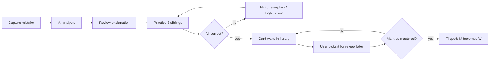
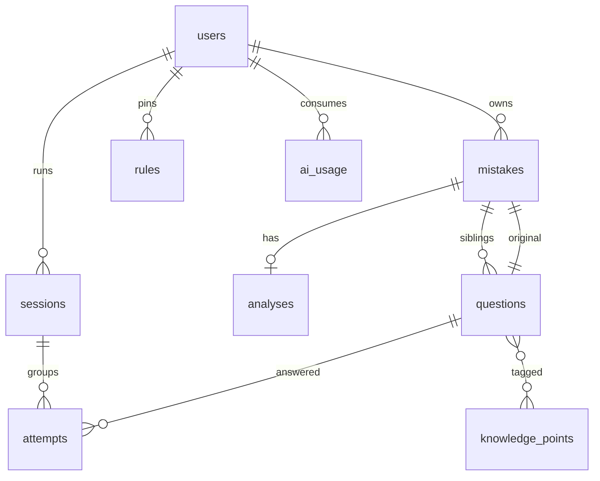

# Wistake — Product & System Architecture

> Status: **Plan only** (not implemented). Companion to [README.md](./README.md).
>
> **Confirmed decisions**:
> - Frontend: existing Vite + React 19 + TS app in `wistake/web`, deployed to Cloudflare Pages (per `package.json`).
> - Backend: Cloudflare Workers (Hono) + **D1** (SQLite) + **R2** (images) + **KV** (rate limits / cache).
> - Auth: simple username/password + JWT, same pattern as [czg plan](../../czg/plan/ARCHITECTURE_AND_EXECUTION_PLAN.md) (§3.2–3.4). Admin-managed accounts, no public sign-up.
> - LLM: **one model only — Gemini 3.5 Flash Lite**, free key from Worker secret `GOOGLE_API_KEY_FREE`; **20 AI analyses per user per day**.
> - Users: **小学 + 初中, Grade 1–9** students + **admin**. No 高中, no parent/teacher view in v1.
> - Subject at launch: **Math only**; schema keeps a `subject` column for later expansion.
> - Review: **no SRS/intervals**. Users pick what to review; app shows *days since last review*.

---

## 1. Product Pillars

| Pillar | Meaning | How it shows up |
| :--- | :--- | :--- |
| **Fast capture** | Logging a mistake must take < 30 s | Photo → OCR → auto-fill; one-screen form |
| **Understand why** | Not just the right answer, the *reason* | Structured AI explanation with root-cause tag |
| **Practice to flip** | M → W only after proven mastery | 3 sibling questions + spaced repetition |
| **See progress** | Motivation via visible growth | Dashboard: flip rate, weak-point radar, streaks |
| **Friendly** | Kid-safe, bilingual, low friction | 中/EN UI, big tap targets, encouraging tone |

---

## 2. User Journey (Core Loop)



### Card lifecycle states
`new` → `analyzed` → `practicing` → `flipped`. **Flipping is a user action** ("I've got it ✓"), suggested when the original + all 3 siblings were answered correctly in the latest attempts. A flipped card can be un-flipped.

---

## 3. Capture: How Users Input a Mistake

### 3.1 Input methods (priority order)
1. **📋 Quick Paste** (v1 primary) — copy question + wrong answer as plain text; see §3.3.
2. **⌨️ Manual form** — structured fields (below), also used to edit a parsed paste.
3. **📷 Photo / screenshot** (Phase 3) — Image → R2 → Gemini vision extracts stem, options, student's answer. User confirms/edits.
4. *(later)* **🔗 In-app import** from other practice modules.

### 3.2 Capture form (single screen)
| Field | Required | Notes |
| :--- | :--- | :--- |
| Stage & grade | ✅ | Remembered from profile; one-tap override |
| Subject | fixed | `math` in v1 (hidden) |
| Math chapter | ✅ | e.g. 一元一次方程 / 分数 / 几何; from grade-specific list, AI-suggested |
| Question type | auto | Detected by AI, user can change |
| Question stem | ✅ | Rich text + LaTeX (KaTeX already a dependency) + image |
| Options | if MCQ | Dynamic list |
| My answer | ✅ | What the student actually wrote |
| Correct answer | optional | If empty, AI solves it and flags `answer_source = ai` |
| Source | optional | e.g. "Unit 3 test", textbook page |
| Self-diagnosis | optional | Quick chips: 粗心 / 不会 / 记错 / 审题 / 时间不够 |
| Tags | optional | Free + suggested |

**Duplicate detection**: normalized-text hash + embedding similarity; warn "You logged a similar one on 10/12 — merge?".

### 3.3 Quick Paste (primary v1 input)
Real input samples: [example-input.md](../data/example-input.md). The user pastes one or more questions into a single textarea and clicks **分析**.

**Paste format (loose, AI-parsed):**
```text
5. 一本画册 92 页，明明第一天看了 12 页，第二天看了 18 页，第三天应该从（________）页开始看起。
answer: 19

5. 两个数相加，第一个加数增加 23，第二个加数减少 19，得数（________）。
* ① 增加 4
* ② 减少 4
* ③ 不变
ansewr: ②
```

**Parsing rules:**
- `answer:` line = **the student's wrong answer** (not the key). Tolerate typos/variants: `ansewr`, `答案`, `我的答案`, full-width `：`.
- Blank line or a new leading number (`5.`) = next question; leading numbers are ignored (both samples are "5.").
- Lines starting with `*`, `-`, or circled numbers `①②③` = MCQ options → `type: mcq`; otherwise blank `（____）` → `numeric`/`cloze`.
- Correct answer is not given → AI solves it (`answer_source = ai`). If AI's answer equals the student's answer, ask the user to confirm instead of analyzing.
- Grade + chapter: AI suggests (e.g. both samples ≈ 小学二/三年级, 100以内加减 / 和的变化), user confirms with one tap.
- Multi-question paste → preview list of parsed cards → **全部分析** (each question uses 1 of 20 daily quota).

**Expected AI result for the samples (sanity reference for prompt tests):**

| | Sample 1 (page reading) | Sample 2 (sum change) |
| :--- | :--- | :--- |
| Student / correct | 19 / **31** | ② 减少 4 / **① 增加 4** |
| Error type | `misread` 审题 — 19 = 18 + 1: only counted day 2, forgot day 1 (correct: 12 + 18 = 30, 30 + 1 = 31) | `concept` 概念不清 — reversed direction: +23 −19 = +4 |
| Avoid next time | 先算"已经看了多少页"，再 +1 得到"从哪页开始" | 和的变化 = 加数变化相加；增加记 +，减少记 −，结果为正即增加 |
| 3 siblings | same topic: "已读 N 页，从第几页开始" with different days/numbers; one variant asks "还剩多少页" | same topic: two addends change in different directions; one variant uses 差的变化 as stretch |

These two samples become fixtures in the prompt regression test (parse → analyze → validate correct answer + error type).

---

## 4. Question Types (Online-Friendly)

All types share one JSON schema with a `type` discriminator so rendering, grading and generation are uniform.

| Type | Key | Auto-grade | Good for |
| :--- | :--- | :--- | :--- |
| Numeric answer | `numeric` | tolerance / equivalent fraction (`3/4` = `0.75`) | Computation, word problems |
| Expression | `expr` | symbolic equivalence (math.js / nerdamer) | Algebra, simplify, factor |
| Single choice | `mcq` | exact | Concepts, geometry |
| Multiple choice | `mcq_multi` | set match | Properties, "which are true" |
| True / False | `tf` | exact | Concept checks |
| Fill-in-blank (multi) | `cloze` | per-blank numeric/expr | Formulas, equations |
| Step-by-step | `steps` | per-step MCQ/numeric | Multi-step solutions |
| Short answer | `short` | **LLM-graded** with rubric | Proofs, explanations |

Math input: on-screen keypad (fractions, √, π, x², ±) + KaTeX live preview; geometry figures as uploaded image or SVG.

> Rule: **Generated practice questions must be auto-gradable** (`short` only when the original is `short`, then LLM-graded). This keeps practice instant and cheap.

### 4.1 Unified question JSON
```json
{
  "type": "numeric",
  "stem": "解方程：$3(x-2) = 2x + 5$，则 $x = $ ____",
  "media": [],
  "options": null,
  "answer": { "values": ["11"], "accept": [] },
  "grading": { "mode": "numeric", "tolerance": 0 },
  "knowledge_points": ["math.junior.g7.linear_equation.distributive"],
  "difficulty": 2
}
```

---

## 5. AI Pipeline

### 5.1 Single "analyze" call (Worker `/api/mistakes/:id/analyze`)
Input: question JSON, my answer, correct answer, grade, subject, self-diagnosis, (optional) last 5 mistakes in same knowledge point for personalization.

Output (strict JSON schema, Gemini `responseSchema`):
```json
{
  "solution_check": { "correct_answer": "11", "confidence": 0.97, "agrees_with_user_key": true },
  "explanation": { "...": "see §6" },
  "error_type": "calculation",
  "knowledge_points": ["math.junior.g7.linear_equation.distributive"],
  "difficulty": 2,
  "practice": [ { "unified question JSON": "x3" } ]
}
```

### 5.2 Generating the 3 siblings — "ladder" strategy
| # | Role | Rule |
| :--- | :--- | :--- |
| 1 | **Mirror** | Same concept + same trap, surface details changed |
| 2 | **Variant** | Same concept, different form/type (e.g. numeric → mcq, or word problem) |
| 3 | **Stretch** | Same concept, +1 difficulty or combined with a related point |

### 5.3 Quality gates (in Worker, before saving)
1. JSON schema validation; retry once on failure.
2. **Self-solve check**: second call (same Flash Lite model) answers each generated question blind; mismatch → discard & regenerate that item. For `numeric`/`expr`, also verify with math.js in the Worker.
3. Grade-appropriateness: chapter list per grade in prompt (e.g. 小学 no negative numbers / unknowns unless chapter allows).
4. Dedup vs. existing questions (hash + similarity).
5. Safety filter (kid-safe content).

### 5.4 Ops
- Single model `gemini-3.5-flash-lite` called from the Worker only (key never reaches the browser); model id in one constant. Model + prompt version stored on every record (`ai_model`, `prompt_version`) for reproducibility.
- **Quota: 20 analyses per user per day** (KV counter keyed `quota:{user}:{YYYY-MM-DD}`, Asia/Shanghai). Regenerate counts as 1; self-solve checks don't count. Admin can override per user. UI shows "今日剩余 AI 次数 12/20".
- Cache by `question_hash + grade` → reuse analysis for identical questions across users.
- Async UX: show skeleton + streaming explanation; practice loads when ready.
- User actions: 👍/👎 on explanation, "Regenerate practice", "Explain simpler", "Report wrong answer".

---

## 6. Explanation Structure

Fixed sections → consistent, scannable UI (collapsible cards). Bilingual: Chinese primary for 小学/初中, toggle EN.

| Section | Content | UI |
| :--- | :--- | :--- |
| ✅ **Correct answer** | Answer + one-line reason | Green banner |
| ❌ **Why your answer is wrong** | Specific to *their* answer, not generic | Red card quoting their answer |
| 🧠 **Root cause** | `error_type` + plain-language diagnosis | Tag chip + sentence |
| 📘 **Key concept** | Rule / formula, with 1 example | Highlight box (KaTeX) |
| 🪜 **Step-by-step** | Numbered solving steps | Stepper, reveal one by one |
| 🛡️ **How to avoid next time** | 1–3 actionable checks ("去括号时每一项都要乘，注意符号") | Checklist, savable as "My Rules" |
| 🔗 **Related points** | Linked knowledge points | Chips → filter view |

### Error type taxonomy (`error_type`)
`concept` 概念不清 · `formula` 公式记错 · `careless` 粗心 · `misread` 审题错误 · `method` 方法不当 · `calculation` 计算错误 · `sign` 符号错误 · `unit` 单位/格式 · `time` 时间不足.

**My Rules notebook**: every "how to avoid" item can be pinned; shown as a daily tip and in pre-exam review.

---

## 7. Practice & Re-Practice

### 7.1 Session types
| Mode | Picks | When |
| :--- | :--- | :--- |
| **Sibling Drill** | 3 generated questions of one mistake | Right after analysis |
| **Pick & Review** (main) | Cards the user selects in the library | Any time |
| **Focus Mode** | All cards of one chapter / error type | From dashboard weak point |
| **Fresh Variant** | AI makes *new* siblings for a card (uses 1 quota) | When siblings feel memorized |

> No automatic scheduling. The app never says "due"; it only shows **days since last review**.

### 7.2 Selecting items (Library)
- Each card shows: chapter, error type chip, accuracy, and a **"上次复习 N 天前"** badge (never reviewed → "未复习"). Badge color warms with age: 0–3 d grey · 4–14 d amber · 15+ d red — informational only.
- Sort: days since last review (default, oldest first) · created date · accuracy · chapter.
- Filter bar: grade · chapter · state (active / flipped) · error type · tag.
- Multi-select checkboxes + "Select all filtered" → **"Review selected (n)"**.
- Per card choice of what to review: original only · original + siblings.

### 7.3 Practice UX
- One question per screen, instant feedback, swipe/Enter to continue.
- Wrong → show short explanation + "Try a similar one" (pulls next sibling).
- Hint ladder: hint 1 (concept) → hint 2 (first step) → show answer (counts as wrong).
- Confidence tap after answering: 😕 guessed / 🙂 sure — shown in card history; guessed-correct doesn't count toward the flip suggestion.
- Session end: score, per-card result, and a prompt "标记为已掌握？" for cards answered fully correct → confetti on flip.
- Finishing a session updates each card's `last_reviewed_at` (resets the "N 天前" badge).

---

## 8. Result Recording

Every answer = one immutable `attempts` row. Card state is derived/updated from attempts.

Recorded per attempt: question id, card id, session id, response (raw), is_correct, time_ms, hints_used, confidence, mode, device, timestamp.

Derived metrics (computed in SQL views or nightly cron Worker):
- Per card: attempts, accuracy, last_reviewed_at (→ days since), last_result.
- Per chapter / knowledge point: accuracy over recent attempts.
- Per user/day: questions done, minutes, flips, streak.

Offline: attempts queued in IndexedDB and synced when online (idempotent by client-generated UUID).

---

## 9. Data Model (D1 / SQLite)



| Table | Key columns |
| :--- | :--- |
| `users` | id, username (unique), password_hash, salt, role (`admin`/`student`), is_active, display_name, stage, grade, ai_daily_limit (default 20), created_at |
| `mistakes` | id, user_id, subject (`math`), stage, grade, chapter, source, self_diagnosis, error_type, state, last_reviewed_at, review_count, flipped_at, created_at |
| `questions` | id, mistake_id, role (`original`/`mirror`/`variant`/`stretch`/`fresh`), type, payload_json, answer_json, difficulty, image_key, hash, ai_model, prompt_version |
| `analyses` | id, mistake_id, my_answer, correct_answer, answer_source, explanation_json, rating, ai_model, prompt_version |
| `attempts` | id (client uuid), user_id, question_id, session_id, response_json, is_correct, time_ms, hints_used, confidence, created_at |
| `sessions` | id, user_id, mode, filters_json, started_at, ended_at, score |
| `knowledge_points` | id (dotted path), subject, stage, name_cn, name_en, parent_id |
| `question_kp` | question_id, kp_id |
| `rules` | id, user_id, mistake_id, text, pinned |
| `ai_usage` | id, user_id, date, kind (`analyze`/`regenerate`/`grade`), mistake_id, tokens — audit log; KV holds the fast counter |

Days since last review = `floor((now - last_reviewed_at) / 1 day)`, computed on the client.

Grade enum: `stage ∈ {primary, junior}`, `grade ∈ 1..9` (1–6 小学, 7–9 初中; display: 小学二年级 / 初一 / Grade 7). Stage is derived from grade.

---

## 10. API Surface (Workers)

| Method | Path | Purpose |
| :--- | :--- | :--- |
| POST | `/api/upload` | Signed R2 upload for photo |
| POST | `/api/mistakes/extract` | Image/text → structured draft (no save) |
| POST | `/api/mistakes` | Save mistake + original question |
| POST | `/api/mistakes/:id/analyze` | Run AI analysis + generate 3 siblings |
| POST | `/api/mistakes/:id/regenerate` | New siblings (`fresh`) |
| GET | `/api/mistakes?filters` | List / search |
| GET | `/api/quota` | Today's remaining AI uses |
| POST | `/api/sessions` / `PATCH /api/sessions/:id` | Start / finish session |
| POST | `/api/attempts` (batch) | Record answers, update `last_reviewed_at` |
| POST | `/api/mistakes/:id/flip` | Mark mastered / un-flip |
| POST | `/api/grade/short` | LLM grading for short answers |
| GET | `/api/stats/*` | Dashboard aggregates |
| GET | `/api/export.pdf` | Printable mistake sheet |

### 10.1 Auth & Admin (mirrors czg §3.2–3.4)
- Password hashing: native **WebCrypto PBKDF2/SHA-256** + per-user salt (no Better-Auth, stays within free-tier 50 ms CPU).
- Token: **Hono JWT** (payload: `sub`, `role`, `exp` 7 d), stored in `localStorage`, sent as `Authorization: Bearer`.
- Built-in admin seeded on first boot from Worker secrets `ADMIN_USERNAME` / `ADMIN_PASSWORD` (`wrangler secret put`, never committed); cannot be deleted or demoted. Other secrets: `JWT_SECRET`, `GOOGLE_API_KEY_FREE`.

| Method | Path | Purpose |
| :--- | :--- | :--- |
| POST | `/api/auth/register` | Disabled → 403 "请联系管理员开通" |
| POST | `/api/auth/login` | Username + password → JWT |
| GET | `/api/auth/me` | Current user + remaining quota |
| PUT | `/api/auth/password` | User changes own password |
| GET | `/api/admin/users` | List users, status, today's AI usage, mistake count |
| POST | `/api/admin/users` | Create student/admin account |
| PUT | `/api/admin/users/:id/access` | Activate/deactivate, role, grade, `ai_daily_limit` |
| PUT | `/api/admin/users/:id/password` | Reset password |
| DELETE | `/api/admin/users/:id` | Delete user + all their data (cascade, R2 images too) |

Only `role === 'admin'` can hit `/api/admin/*` (Hono middleware) or see the Admin tab. Deactivated users get 401 on next request.

---

## 11. Dashboard

### 11.1 Home (student)
- **Hero actions**: "📷 记一道错题" (primary) and "复习错题" → Library.
- **Stale nudge** (informational): "有 5 道题超过 14 天没复习" → opens Library sorted oldest first.
- **AI quota pill**: "今日剩余 12/20".
- **Streak flame** (days with ≥ 1 review).
- **M → W counter**: total mistakes vs flipped, animated flip.

### 11.2 Stats page
| Widget | Chart | Insight |
| :--- | :--- | :--- |
| Flip progress | Stacked bar by state over time | Is the backlog shrinking? |
| Weak points | **Radar** by math chapter | Where to focus |
| Error types | Donut | 粗心 vs 不会 — different fixes |
| Activity | GitHub-style **heatmap** | Consistency |
| Accuracy trend | Line (7/30/90 d) | Improvement |
| Chapter breakdown | Treemap | Distribution |
| Review freshness | Histogram of days since last review (0–3 / 4–7 / 8–14 / 15–30 / 30+) | What's going stale |
| Top recurring | Ranked list | "Repeat offenders" |

Each widget is clickable → opens Focus Mode with that filter.

### 11.3 Admin console
- User table: username, grade, active toggle, role, AI used today / limit, mistakes count, last login.
- Actions: add user, reset password, edit limit, deactivate, delete (with confirm).
- Global stats: total AI calls today, failed generations, 👎 rate on explanations.

*(Parent/teacher view: not in v1.)*

Charts: lightweight library (e.g. Recharts or hand-rolled SVG) to stay small.

---

## 12. UX & Design System

- **Visual**: dark-first glassmorphism; brand colors red (M) → green (W) gradient; flip animation as the signature micro-interaction.
- **Mobile-first PWA**: installable, camera access, offline review.
- **Bilingual** 中/EN toggle; age-adaptive copy (小学: emoji + simpler words; 初中: concise).
- **Accessibility**: 44px tap targets, keyboard shortcuts on desktop (1–6 options, Enter next), high contrast.
- **Encouraging tone**: never "Wrong!", instead "Almost — here's the trap."
- **Gamification (light)**: streaks, flip badges per chapter.
- **Printing**: export selected mistakes + siblings as a clean A4 PDF worksheet (with answer key on last page).

---

## 13. Privacy, Safety, Cost

- Minimal PII for minors; images auto-stripped of EXIF; user can delete any mistake (cascade).
- LLM prompts exclude names; no training on user data.
- Content safety filter on generated text.
- Cost control: 20/day quota, caching identical questions, single free-tier Flash Lite model.

---

## 14. Delivery Roadmap

| Phase | Scope | Exit criteria |
| :--- | :--- | :--- |
| **0 – Foundations** | D1 schema, PBKDF2+JWT auth, seeded admin, admin console, design tokens | Admin creates a student; student logs in |
| **1 – MVP loop** | Manual capture (math keypad + KaTeX), analyze, 3 siblings (numeric/mcq/tf), quota | Student can log → understand → practice |
| **2 – Library & Dashboard** | Pick & Review, days-since badges, flip, core charts | Student reviews selected cards end-to-end |
| **3 – Photo capture** | R2 upload, vision extraction, dedup | < 30 s capture from photo |
| **4 – Rich types** | expr, cloze, steps, short (LLM graded) | All §4 types render & grade |
| **5 – Export & offline** | PDF worksheet export, PWA offline | Printable sheet; offline review syncs |
| **Later** | More subjects, parent view | — |

---

## 15. Open Questions

None at the moment. Decisions log: simple auth + admin (czg pattern) · Math only · Grade 1–9 · 20 AI/day · Gemini 3.5 Flash Lite (free key) · manual review with days-since · admin creds as Worker secrets.
